<div align="center">


[](https://www.freepascal.org/)
[](#-getting-started)
[](#-class-programs)
[](#-weekly-assignments)
[](#-final-project-bingo)

**My first programming course, in a single repository:**
133 small programs written in class, ten weekly assignments, and a 670-line Bingo game to finish the semester.

[🧭 Roadmap](#-learning-roadmap) · [📓 Class programs](#-class-programs) · [🗓️ Assignments](#-weekly-assignments) · [🎱 Bingo](#-final-project-bingo) · [🚀 Getting started](#-getting-started) · [🗂️ Structure](#-repository-structure)

</div>

---

## ✨ What is this?

Everything I wrote while learning **Pascal** (Free Pascal, `objfpc` mode) between **September and December 2024**: tiny exercises on variables and loops at the start, and by the end a full program that reads a game from a file, validates it and plays it.

> *"Make it work, make it clear, then make it small."*

| | |
|---|---|
| 📓 **Class programs** | 133 numbered files in [`programas/`](programas), from `00.holapi.p` to `64a.ptrint.p` |
| 🗓️ **Assignments** | Dated folders, one per weekly *Tarea* (29-09 → 22-12) |
| 🎱 **Final project** | Bingo with colours, several players and cards, input validation and a winner |
| 🚢 **Mid-term project** | Battleship: reads a fleet from a file, draws the board and answers shots |
| 📏 **Code** | ~5,400 lines of class programs + ~1,400 in the four biggest assignments |
| ✅ **Build status** | 160 of the 165 source files compile out of the box with `fpc 3.2.2`; the rest are unfinished drafts |

> 🌐 **Note:** comments and identifiers are in Spanish, following the course. This README is in English.

---

## 🧭 Learning roadmap

```mermaid
flowchart LR
    A["🌱 Basics<br/>types, expressions,<br/>chars"] --> B["🔧 Functions<br/>& procedures"]
    B --> C["🔀 Control flow<br/>if, case, loops"]
    C --> D["🧩 Custom types<br/>enums, records"]
    D --> E["📚 Arrays<br/>& strings"]
    E --> F["📄 Text files<br/>& parsing"]
    F --> G["🔗 Pointers<br/>dynamic memory"]
    G --> H["🎱 Bingo<br/>everything together"]
    style A fill:#1f6feb,color:#fff,stroke:none
    style B fill:#8957e5,color:#fff,stroke:none
    style C fill:#db61a2,color:#fff,stroke:none
    style D fill:#e67e22,color:#fff,stroke:none
    style E fill:#2ea44f,color:#fff,stroke:none
    style F fill:#0e8a8a,color:#fff,stroke:none
    style G fill:#7f8c8d,color:#fff,stroke:none
    style H fill:#c0392b,color:#fff,stroke:none
```



---

## 📓 Class programs

The [`programas/`](programas) folder holds the exercises solved in class. Each file starts with a one-line description and the command to run it. Variants of the same exercise are suffixed `a`, `b`, `c`… (for example `06.bisiesto.p`, `06b.bisiesto.p`, `06c.bisiesto.p`) so you can see an idea evolve from a first attempt to a cleaner solution.

<table>
<tr>
<td width="50%" valign="top">

### 🌱 Basics · `00 – 09`
Hello Pi, scopes, comparing reals, circumference and circle area, expressions, leap years, `char` expressions, factorial of 5, volume of a hollow cylinder.

📂 [`00.holapi`](programas/00.holapi.p) · [`04.compfloat`](programas/04.compfloat.p) · [`06.bisiesto`](programas/06.bisiesto.p) · [`09.volcilh`](programas/09.volcilh.p)

</td>
<td width="50%" valign="top">

### 🔧 Functions & integers · `10 – 16`
Splitting digits, useful `char` functions, modular arithmetic, maximum, sign, point farthest from the origin, value of a hexadecimal digit.

📂 [`10.digitos`](programas/10.digitos.p) · [`12.mod`](programas/12.mod.p) · [`15.valorhex`](programas/15.valorhex.p) · [`16.hexdigitos`](programas/16.hexdigitos.p)

</td>
</tr>
<tr>
<td width="50%" valign="top">

### 🔀 Procedures & scopes · `17 – 25`
Is this date valid?, playing with variables, ordering two numbers, squares, `var` parameters (`incr`), scope rules, sorting two points by their distance to the origin.

📂 [`17.fechaok`](programas/17.fechaok.p) · [`20.ord2`](programas/20.ord2.p) · [`23.incr`](programas/23.incr.p) · [`25.ordpt`](programas/25.ordpt.p)

</td>
<td width="50%" valign="top">

### 🧩 Enums & records · `26 – 35`
Quadratic equations, days of the week, enumerated types, the next day of a date, records, geometry, Spanish playing cards, complex numbers and a game of **siete y medio** (7½).

📂 [`26.ec2`](programas/26.ec2.p) · [`28.enums`](programas/28.enums.p) · [`31.records`](programas/31.records.p) · [`34.compl`](programas/34.compl.p) · [`35.7y12`](programas/35.7y12.p)

</td>
</tr>
<tr>
<td width="50%" valign="top">

### 🔁 Loops · `36 – 43`
Read until 0, multiplication tables (also backwards), squares below 100, matrices, drawing triangles with `#`, the first prime numbers.

📂 [`36.tabladel`](programas/36.tabladel.p) · [`38.matriz`](programas/38.matriz.p) · [`40.triang`](programas/40.triang.p) · [`43.primos`](programas/43.primos.p)

</td>
<td width="50%" valign="top">

### 📚 Arrays & searching · `44 – 52`
Arrays, sums and averages of marks, add / multiply until 0, find a 0, are all 0?, min and max, **selection sort**, sequential and **binary search**.

📂 [`44.arrys`](programas/44.arrys.p) · [`50.minmax`](programas/50.minmax.p) · [`51.sort`](programas/51.sort.p) · [`52.buscarbin`](programas/52.buscarbin.p)

</td>
</tr>
<tr>
<td width="50%" valign="top">

### 🔤 Strings & sets · `53 – 56`
Playing with strings, palindromes, the value of a 7½ hand, counting characters in a line using **sets**.

📂 [`53.str`](programas/53.str.p) · [`54.pal`](programas/54.pal.p) · [`55.valormano`](programas/55.valormano.p) · [`56.carsetas`](programas/56.carsetas.p)

</td>
<td width="50%" valign="top">

### 📄 Text files · `57 – 63`
Reading and writing files, `EOLN` / `EOF` behaviour, copying a file, careful input of strings and integers, reading words, longest and most repeated word.

📂 [`57.lee`](programas/57.lee.p) · [`58g.lees`](programas/58g.lees.p) · [`59.copia`](programas/59.copia.p) · [`62b.maxrep`](programas/62b.maxrep.p)

</td>
</tr>
<tr>
<td colspan="2" valign="top">

### 🔗 Pointers · `64`
Dynamic words and the first pointer: `new`, `^` and `dispose`.

📂 [`64.paldin`](programas/64.paldin.p) · [`64a.ptrint`](programas/64a.ptrint.p)

</td>
</tr>
</table>

---

## 🗓️ Weekly assignments

Every *Tarea* lives in a folder named after its delivery date (`day-month`).

| Date | Folder | What it covers |
|:--:|:--:|---|
| **29-09** | [📂](29-09) | Warm-up: `ord` / `chr` and ASCII, boolean algebra and **De Morgan's laws**, predecessor and successor, `crt` and `clrscr`, factorial with `longint` |
| **30-09** | [📂](30-09) | Swap letter case with `case`, digits and their value, parity, are two letters ordered?, rectangle area, sphere volume, comparing areas, quadratic equation with **complex roots** |
| **01-10** | [📂](01-10) | `while` loops (four exercises) and the **same assignment refactored into functions**: `Area1`, `Volumen`, `Area2`, `Discriminante`, `Re`, `Im` |
| **09-10** | [📂](9-10) | Grades: a test letter (A / B / C) plus an exam mark → average, pass / fail, minimum of 2 and of 3 numbers |
| **16-10** | [📂](16-10) | Improved grades assignment (lower-case letters accepted) and a scratch file on procedures |
| **02-11** | [📂](02-11) | **Custom types**: Spanish deck (`Oros`, `Bastos`, `Copas`, `Espadas`), NIF (number + letter), player ranks and a hand of three cards. The [`SEGUNDA/a`](02-11/SEGUNDA/a) folder also draws triangles |
| **07-11** | [📂](07-11) | 🚢 **Battleship, part 1**: ship classes, sizes, orientation and state (`Intacto`, `Tocado`, `Hundido`), placing the fleet on a board |
| **19-11** | [📂](19-11) | 🚢 **Battleship, part 2**: reads the fleet from `datos.txt`, draws the board and answers a list of shots |
| **29-11** | [📂](29-11) | Work in progress: processing words from a text file (`EsBlanco`, `addcar`). *Unfinished, does not compile yet* |
| **22-12** | [📂](22-12) | 🎱 **Final project: Bingo** |

---

## 🚢 Battleship

[`19-11/Tarea.p`](19-11/Tarea.p) reads a fleet and a list of shots from a text file. Each ship is `class orientation column row`, the fleet ends with `FIN`, and every pair after that is a shot.

```text
Submarino Horizontal B 2        ← one-cell submarine at B2
Fragata   Vertical   C 3        ← 3-cell frigate going down from C3
FIN                             ← (words can be split across lines)
A 1                             ← shots
B foo
C 4
```

```text
$ fpc -gl Tarea.p && ./Tarea < datos.txt
. . . . . . . . . .
. S . . . . . . . .
. . F . . . . . . .
. . F . . . . . . .
. . F . . . . . . .
. . . . . . . . . .
. . . . . . . . . .
. . . . . . . . . .
. . . . . . . . . .
. . . . . . . . . .
Agua                    ← A1: miss
Error en la Entrada     ← "B foo" is not a valid shot
Tocado                  ← C4: hit!
```

Ship classes available: `Submarino` (S), `Dragaminas`, `Fragata` (F) and `PortaAviones`.

---

## 🎱 Final project: Bingo

[`22-12/bingo.p`](22-12/bingo.p) is the biggest program of the repo (672 lines, 46 procedures and functions). It reads a whole game from a text file, **validates every word** and plays it round by round.

### How the game works

- **3 players**, each with up to **20 cards**; a card has **3 rows** of **5 numbers** (1 to 99), and every row has a **colour** (`rojo`, `verde`, `azul`, `amarillo`).
- The players are listed first (every player ends with `FIN`), then come the **drawn balls**: a colour and a number each.
- A ball marks a number (`XX`) only in rows of the **same colour**. A player scores *Tachado* when a number is marked and **Bingo** as soon as **one whole row** of a card is marked.
- At the end it announces the winner, or a tie (`Empate`).

### What it practises

| Concept | Where |
|---|---|
| 🧩 Nested **records and arrays** (`TipoGame → TipoJugador → TipoCarton → TipoFila`) | type declarations |
| 🔤 Parsing **words** from a file one character at a time | `LeerPal`, `PalMinusc`, `AddCar` |
| 🛡️ **Input validation** with an `ok` flag passed through every reader | `LeerNum`, `LeerColor`, `LeerFila`, `LeerGame` |
| 📊 **Selection sort** to keep every row ordered | `PosMinDesde`, `SortFila` … `SortGame` |
| 🎯 Matching and winner detection | `MatchGame`, `GanaCarton`, `EndGame`, `Empate` |

### Example run

Two players with the same first row, three players in total, and six balls:

```text
rojo 3 2 10 12 8
verde 3 2 10 12 32
amarillo 3 4 5 2 50
FIN
...
rojo 3          ← balls
rojo 2
verde 32
rojo 10
rojo 12
rojo 8
```

```text
Jugador 1 Carton 1
rojo XX XX 8 10 12
verde 2 3 10 12 32
amarillo 2 3 4 5 50

Jugador 1: Tachado
Jugador 2: Tachado
Jugador 3: Nada
...
Jugador 1: Bingo
Jugador 2: Bingo
Jugador 3: Nada

Empate
```

> 💡 The `datos.txt` included in the folder contains the invalid word `rOjo` on its first line, so the program stops with `Error de Entrada`: a quick way to see the validation in action. Fix it to `rojo` and the game runs.

---

## 🚀 Getting started

You only need the **Free Pascal Compiler** ([freepascal.org](https://www.freepascal.org/download.html), or `sudo apt install fp-compiler` on Debian / Ubuntu).

```bash
git clone https://github.com/EnDriS10/Pascal_2024.git
cd Pascal_2024/programas

fpc -gl 43.primos.p        # compile (-gl = readable error traces)
echo 8 10 11 2 0 | ./43.primos
```

Most class programs read from standard input and say how to run them in their first comment, for example:

```bash
fpc -g -oa.out 43.primos.p && ./a.out
```

### The course directives

The course asks every exercise to start with these compiler directives (also in [`Documento Directivas`](Documento%20Directivas)):

```pascal
{$mode objfpc}{$H-}{$R+}{$T+}{$Q+}{$V+}{$D+}{$X-}{$warnings on}
```

They turn on **range checking** (`{$R+}`), **overflow checking** (`{$Q+}`), **strict variable parameters** (`{$V+}`) and **type-checked pointers** (`{$T+}`), so mistakes show up as clear runtime errors instead of silent bugs. Always compile with `-gl` to get a line-numbered trace when one happens.

> 💡 Programs that read a file (`datos.txt`) expect it in the folder you run them from. Run each assignment from inside its own folder.

---

## 🗂️ Repository structure

```text
Pascal_2024/
├── 📓 programas/        133 numbered class programs (00 → 64a)
├── 🗓️ 29-09/ 30-09/     first assignments: ASCII, logic, factorial, quadratic equation
├── 🗓️ 01/ 01-10/ 9-10/ 16-10/    loops, functions, grades
├── 🗓️ 02-11/            custom types: cards, NIF, triangles
├── 🚢 07-11/ 19-11/     Battleship
├── ✍️ 29-11/             word processing (in progress)
├── 🎱 22-12/            final project: Bingo
└── 📄 Documento Directivas   compiler directives required by the course
```

> 🔢 **Folder names:** assignments are named by delivery date. Numbered sub-folders (`1/`, `2/`…) hold the small exercises of that day.

---

<div align="center">

### 👨‍🔬 Author

**César Acosta Martínez** · [@EnDriS10](https://github.com/EnDriS10)
Physics student

⭐ If this repo helped you learn Pascal, leave it a star!


</div>
